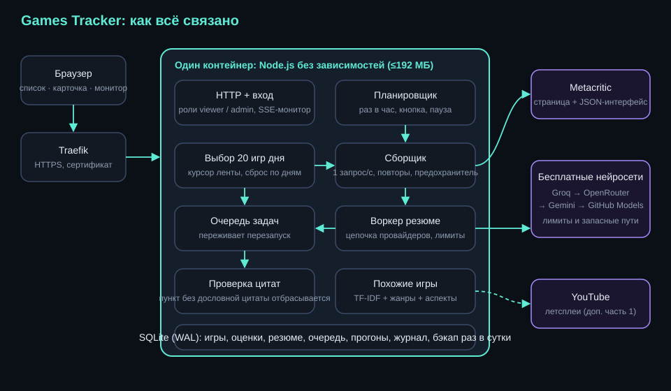

# Games Tracker

Сервис раз в час берёт с [Metacritic](https://www.metacritic.com/game/) 20 новых игр, сохраняет информацию о них, просит нейросеть кратко описать, что в игре нравится и не нравится критикам и игрокам, и показывает всё в веб-интерфейсе с монитором работы в реальном времени.

Один небольшой процесс на Node.js 24 без сторонних библиотек, база SQLite, страницы без фреймворков. Работает в контейнере с жёсткими лимитами (192 МБ памяти, 0,3 процессора).



## Что сделано по заданию

| Требование | Как реализовано |
|---|---|
| Раз в час берёт 20 новых игр, которые сегодня не обрабатывал | Планировщик со слотами по часам; выбор игр с курсором дня (`src/selection.js`), покрыт тестами |
| Первые 20 с главной (New Releases), дальше страницы «SEE ALL, новые», каждый день заново | Блок New Releases разбирается с главной страницы; дальше лента по 20 с точным продолжением; новый день = новые курсоры |
| Добавляет игру или обновляет, если уже есть | Запись по `slug` в одной транзакции; история оценок пишется только при изменении |
| Название, обложка, платформы + Metascore + Userscore, разработчик, описание, ссылка на видео | Карточка и оценки по каждой платформе (PS5, NS2, PC, XSX…), обложка берётся ссылкой |
| Резюме отзывов: что нравится и не нравится, отдельно критики и игроки, обновляется при повторных обходах | Один вызов ИИ на игру, два независимых блока; пересчёт только при изменении отзывов (хеш выборки, порог времени и изменения числа отзывов) |
| Веб-интерфейс: список, карточка, фильтр по платформам, поиск, сортировка по рейтингу | Плюс фильтры по жанру, году и аспекту («где хвалят сюжет»), сортировка по оценке критиков, игроков, разрыву, дате |
| Похожие игры из базы, клик открывает карточку | TF-IDF по описанию и пунктам резюме, жанры, разработчик, профиль аспектов; у каждой причина сходства |
| Доп. часть 1: самый популярный летсплей, речь блогера в текст, заключение со ссылкой | Поиск на YouTube (названия-фильтры: «let's play», «walkthrough», «прохождение»; без трейлеров, обзоров, стримов, роликов про сиквел), берётся самый просматриваемый ролик **с речью**, текст берётся из его субтитров (русских или английских), заключение по тексту пишет нейросеть по-русски; в карточке ссылка на ролик и сворачиваемый текст речи |
| Доп. часть 2: мониторинг в реальном времени и кнопка принудительного запуска | `/monitor`: воркеры, очередь, лимиты нейросетей, источник, живой журнал (SSE); кнопка с паузой и суточным лимитом |

Сверх задания: защита от выдумок в резюме (каждый пункт подтверждён дословной цитатой), аспекты игры, разрыв оценок критиков и игроков, динамика оценок, админка, журнал вызовов ИИ, вход по ролям, бэкап.

## Как работает резюме и почему ему можно верить

Модель получает сбалансированную выборку отзывов (положительные, смешанные, отрицательные; без спойлеров и дублей) и обязана приложить к каждому пункту цитату. Код сверяет цитату с отзывами **той же группы** (критики или игроки): пункт без дословного подтверждения отбрасывается, а слишком слабый ответ уходит на повтор следующему провайдеру. В карточке пункт раскрывается, и видно подтверждение. Для каждого резюме хранится модель, версия подсказки, число отзывов и число отброшенных пунктов.

Провайдеры выстроены в цепочку (бесплатные тарифы): Groq → OpenRouter (только модели `:free`) → Gemini → GitHub Models. Есть суточные потолки, охлаждение после 429, отключение при отказе в доступе, журнал каждого вызова. Если лимиты кончились, данные собираются дальше, а резюме ждут в очереди; игры с наибольшим числом отзывов обрабатываются первыми.

## Управление

* `/` список, `/game/<slug>` карточка, `/monitor` монитор, `/about` пояснения.
* `/admin` (роль admin): пауза и продолжение, запуск вручную с параметрами и пробный запуск, сброс курсора дня, настройки без перезапуска (форма строится из реестра настроек), провайдеры (проверка ключа, включение), очередь, игры (скрыть, закрепить, обработать заново, добавить по ссылке), журнал действий, выгрузка JSON/CSV, скачивание базы.
* Вход по логину и паролю, две роли: `viewer` и `admin`.

## Запуск

Быстрая демонстрация у себя, без нашего сервера, сети и ключей (записанные ответы Metacritic и заглушка вместо нейросети):

```bash
npm run demo      # затем открыть http://localhost:3000 (проверяющий: demo / demo-viewer-1, админ: admin / demo-admin-1)
```

Локально на записанных ответах (без сети и ключей):

```bash
npm test                                   # все проверки
node scripts/hash-password.js <пароль>     # хеш для .env
MOCK=1 SESSION_SECRET=... VIEWER_USER=v VIEWER_PASS_HASH=... ADMIN_USER=a ADMIN_PASS_HASH=... node src/main.js
```

На сервере с Traefik: скопировать `.env.example` в `.env`, заполнить, затем `docker compose up -d --build`. Контейнер не публикует портов, подключается к сети Traefik и получает HTTPS-маршрут по меткам из `compose.yaml`.

## Тесты

`npm test`: проверки выбора игр дня (повторы, смена дня, продолжение ленты), разбора ответов Metacritic на записанных ответах, клиента (повторы, лимит запросов, предохранитель), планировщика (один прогон, восстановление после падения, пауза, ограничения кнопки), цепочки нейросетей (429, отказ в доступе, лимиты, кривой JSON), проверки цитат, очереди, сервера (вход, роли, защита от подделки запросов, весь путь данных, SSE, админские действия) и статические проверки интерфейса (нет `innerHTML`, inline-скриптов и стилей).

## Ограничения

* Нейросети используются только по бесплатным тарифам, число резюме в сутки ограничено; у остальных игр пометка «резюме в очереди».
* Резюме строится по выборке отзывов (до 40 каждого вида), а не по всем.
* Летсплеи: речь берётся из субтитров ролика (распознавание звука нейросетью в бесплатных тарифах недоступно), поэтому у роликов без субтитров заключения нет, берётся следующий по просмотрам. Летсплеи, как бонус, работают, пока в дневном бюджете нейросетей осталось больше 30%: остальное зарезервировано под резюме. Поиск идёт через публичную страницу YouTube без ключа; официальный API включается настройкой.
* «Разрыв критиков и игроков» это разница двух оценок, а не доказательство накрутки.
* Внутренний интерфейс Metacritic не документирован: при смене формата сервис помечает прогон как ухудшенный и показывает красный статус источника.

## Данные

Данные и торговые знаки Metacritic принадлежат их владельцам; сервис использует их только для демонстрации, обращается к сайту не чаще одного запроса в секунду.
